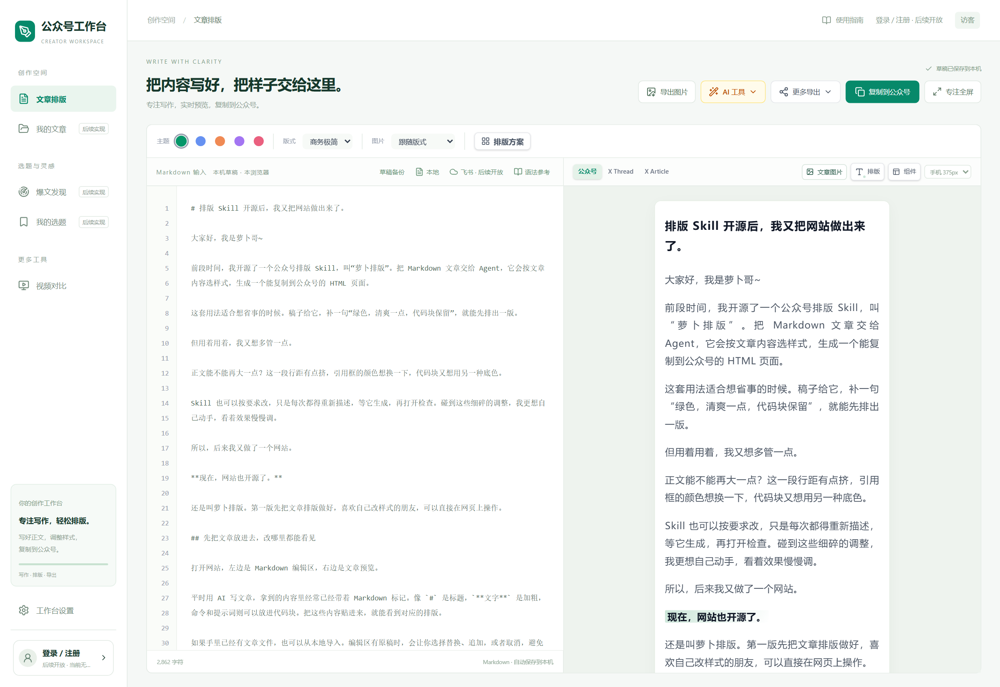
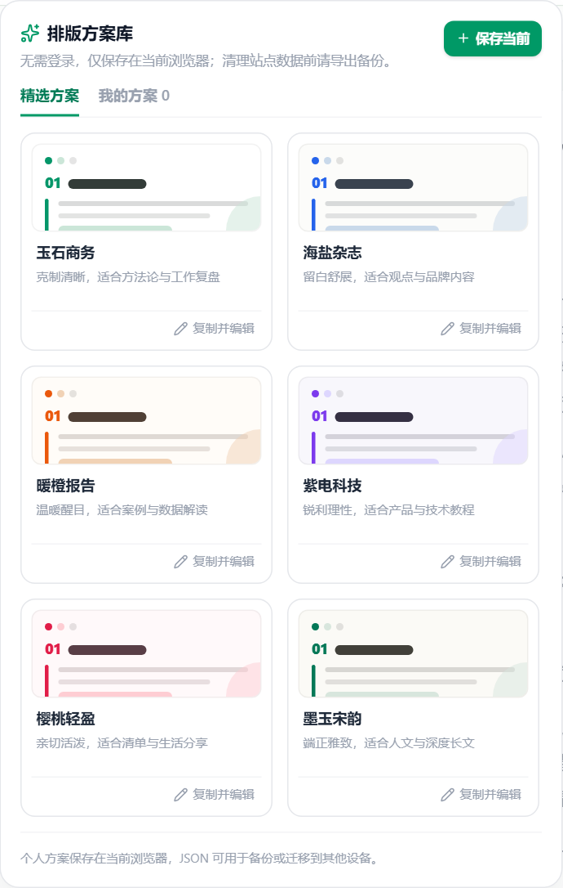
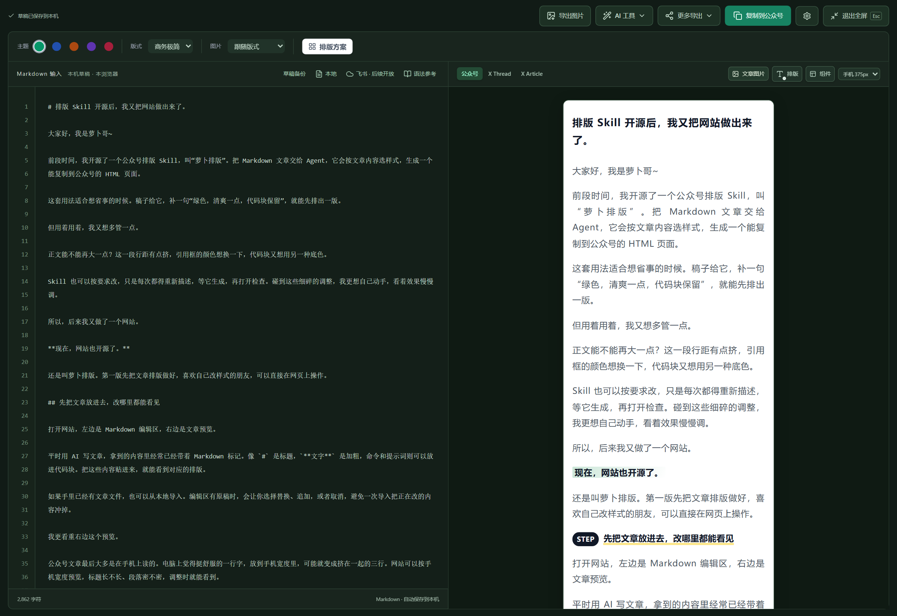
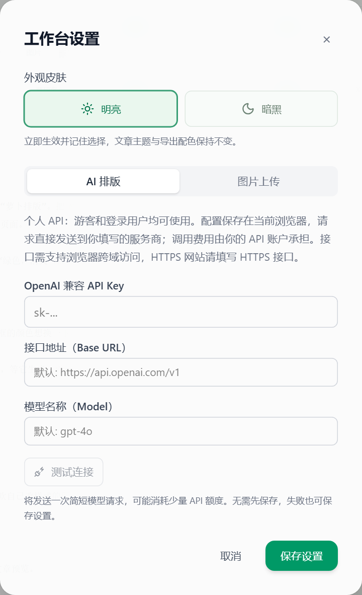
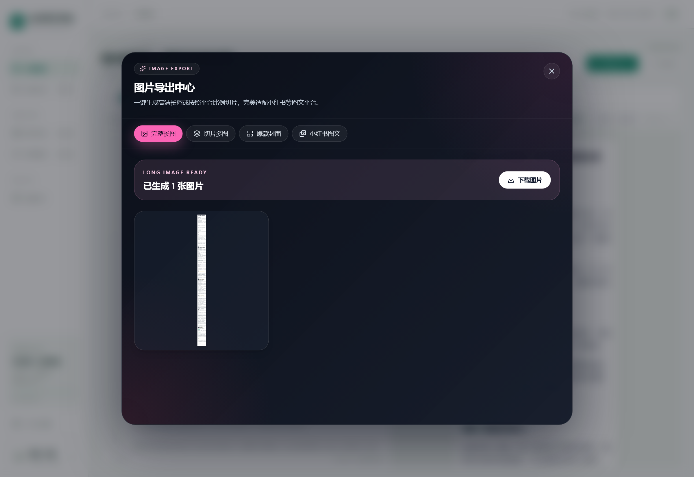
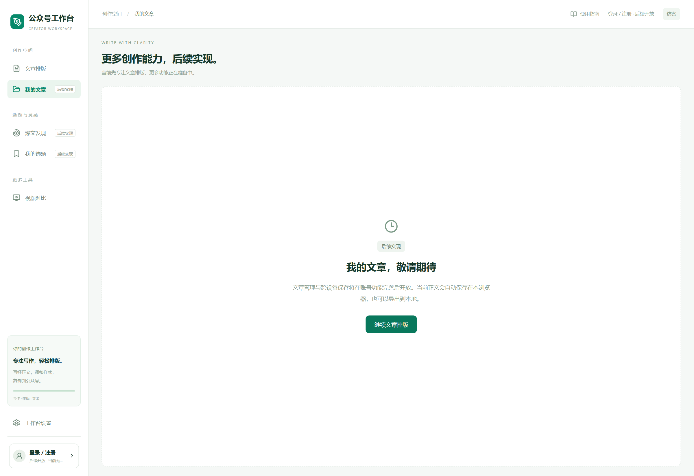

# 公众号 Markdown 排版系统

把正文写进 Markdown 编辑器，实时调整文章样式，再复制到公众号或导出图片。

[在线体验](https://gzh.chatgptdaily.com.cn/) · [本地部署](docs/LOCAL_DEPLOYMENT.md) · [服务器部署](docs/SELF_HOSTED.md)

## 网站预览

以下为当前生产构建在本地运行的真实界面截图，示例正文仅用于演示排版；公网界面以实际部署版本为准。

### 双栏编辑与实时预览

左侧写正文，右侧查看公众号排版效果，主题、版式和图片样式随时切换。



### 风格方案与排版细节

先选一套完整风格，再按喜好调整字号、行距、段落间距和左右边距。

| 整套风格方案 | 正文排版设置 |
| --- | --- |
|  |  |

### 暗黑皮肤与专注全屏

收起外围界面，给编辑和预览留出更多空间。工作台皮肤与文章导出配色独立设置。



### 个人 API 设置与连接测试

无需登录即可填写 API Key、接口地址与模型，保存前可测试连接。配置保存在当前浏览器，测试会向填写的服务商发起一次短请求，费用由个人 API 账户承担。截图未填写密钥。



### 图片导出

支持文章长图、按平台比例切片，以及封面制作，方便把同一篇内容整理成不同发布形式。



<details>
<summary>后续功能规划</summary>

“我的文章、爆文发现、我的选题”和账号功能目前保留规划入口，后续逐步开放。



</details>

## 当前公开功能

当前版本专注文章排版，无需登录即可使用：

- Markdown编辑与实时公众号预览，支持主题、版式、字体、字号、行距、边距、强调及组件样式。
- 顶部“排版方案”统一管理六套精选方案与本机个人方案，支持保存、改名、编辑、删除和JSON导入导出。
- 明亮与暗黑皮肤、专注全屏，工作台皮肤与文章导出配色独立。
- 本地Markdown/TXT文件导入，替换或追加前确认，支持撤销。
- 正文自动保存到本浏览器；“草稿备份”支持手动备份、每分钟变化版本、恢复确认与JSON文件迁移。
- 个人API设置与连接测试，AI排版、封面和图文生成使用用户填写的服务商。配置仅存当前浏览器，接口需要支持浏览器跨域访问，调用费用由个人API账户承担。
- 复制到公众号、X Thread及X Article预览和复制，文章长图、切片、封面及小红书图文导出。
- 文章图片检测与更换链接，以及自定义图床或Base64选项。
- 视频对比工具。图片导出、配图面板、语法参考、X预览和视频对比按需加载。

用户已于2026-11-18确认真实公众号后台粘贴效果正常，详见[验收记录](docs/WECHAT_EXPORT_QA.md)。不同图片来源仍需按实际情况检查。

## 暂未开放

登录、注册、用户中心、我的文章、爆文发现和我的选题显示后续开放说明。服务器图床上传、飞书导入、云端预设、会员平台API与支付也未在生产开放。“配置与诊断”仅供本地开发，生产直接访问/admin会返回排版首页。

RedFox文章库、账号、文章管理和选题代码保留供本地开发，生产接口关闭。浏览库与外部采集分开，采集结果入库，浏览不自动请求供应商；不依赖粉丝数据。详见[发布范围](docs/RELEASE_SCOPE.md)和[产品待办](docs/TODO.md)。

## 本地运行与部署

使用兼容Node.js版本：22.22.2或24.13及以上，以server/package.json为准。项目采用React、TypeScript、Vite和Node.js，SQLite保存业务数据，文件目录保存图片，无需部署Cloudflare或单独数据库。

在项目根目录依次执行：

```bash
cd app
npm ci
npm run build:server
cd ../server
npm ci
npm run build
```

首次运行将server/.env.example复制为server/.env，按注释设置PUBLIC_URL、HOST和PORT，再在server目录执行npm start。环境文件不进入Git；已有.env、数据库、图片和加密密钥在更新时保留。

- [下载ZIP后的Windows/Linux本地运行指南](docs/LOCAL_DEPLOYMENT.md)
- [Linux、systemd及现有Nginx完整部署指南](docs/SELF_HOSTED.md)

公网部署沿用专用用户gzh、项目目录/home/gzh/gongzhonghao、回环端口3100及Nginx HTTPS代理。首次部署完成后，root可执行：

```bash
bash /home/gzh/gongzhonghao/deploy/update.sh
```

脚本自动以gzh执行Git/npm，以root重启服务并检查健康状态。完整选项及失败处理见[更新脚本](deploy/update.sh)和部署指南。

## 本地开发

先在server目录安装依赖并运行npm run build，再在app目录安装依赖并执行npm run dev。本地开发可以调测账号和二期功能；真实供应商采集仍需要管理员凭证与预算，不随本地浏览自动调用。

生产构建使用npm run build:server。不要通过修改NODE_ENV绕过生产发布限制。详细开关见[发布范围](docs/RELEASE_SCOPE.md)。

## 数据与备份

- 正文、历史备份、排版方案及个人API设置保存在当前浏览器，清理站点数据会丢失。草稿与方案可分别导出JSON迁移；导出文件不含API密钥或登录凭证。
- 草稿历史最多20版、约2MB；本机方案最多30套。历史容量满后自动淘汰最旧版本，重要稿件请另存文件。
- 服务端数据默认在server/data，备份和恢复时保留SQLite、图片目录及配套密钥。当前生产账号和云端文章功能未开放。
- 本机历史版本不提供跨设备自动同步，也不提供多个标签页实时协同编辑。

## 项目结构

| 路径 | 内容 |
| --- | --- |
| app | React前端、排版、复制和图片导出 |
| server | Node服务、SQLite适配、管理脚本与测试 |
| worker | 保留的共享后端和旧Cloudflare源码，Node构建仍会引用 |
| deploy | Linux服务、Nginx模板与一键更新脚本 |
| docs | 部署、功能、验收及待办说明 |
| skills | 排版Skill源码 |

## 使用与验证文档

- [本机草稿、备份与恢复](docs/LOCAL_DRAFTS.md)
- [本机排版预设](docs/LOCAL_PRESETS.md)
- [个人API与连接测试](docs/PERSONAL_AI.md)
- [文章图片](docs/ARTICLE_IMAGES.md)
- [Markdown语法参考](docs/syntax_tutorial.md)
- [公众号复制验收](docs/WECHAT_EXPORT_QA.md)
- [首屏资源与预设验证](docs/STARTUP_OPTIMIZATION.md)
- [安全加固与验证边界](docs/SECURITY_HARDENING.md)

构建和本地验证通过不代表公网已更新。每次推送后仍需在服务器执行更新，并检查实际页面。

## 历史实现

早期Cloudflare、D1/R2、服务端模型权限及二期说明集中保留在[历史README](docs/archive/README_LEGACY.md)，供维护者查阅，不能作为当前公开功能或部署步骤。
