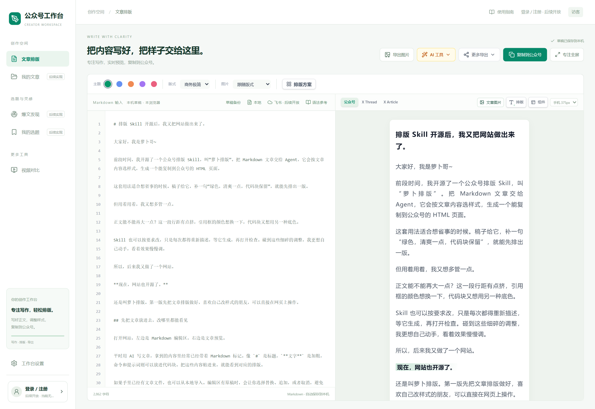
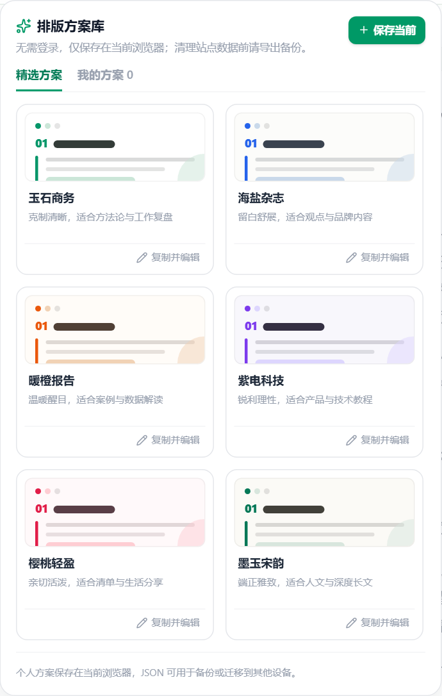
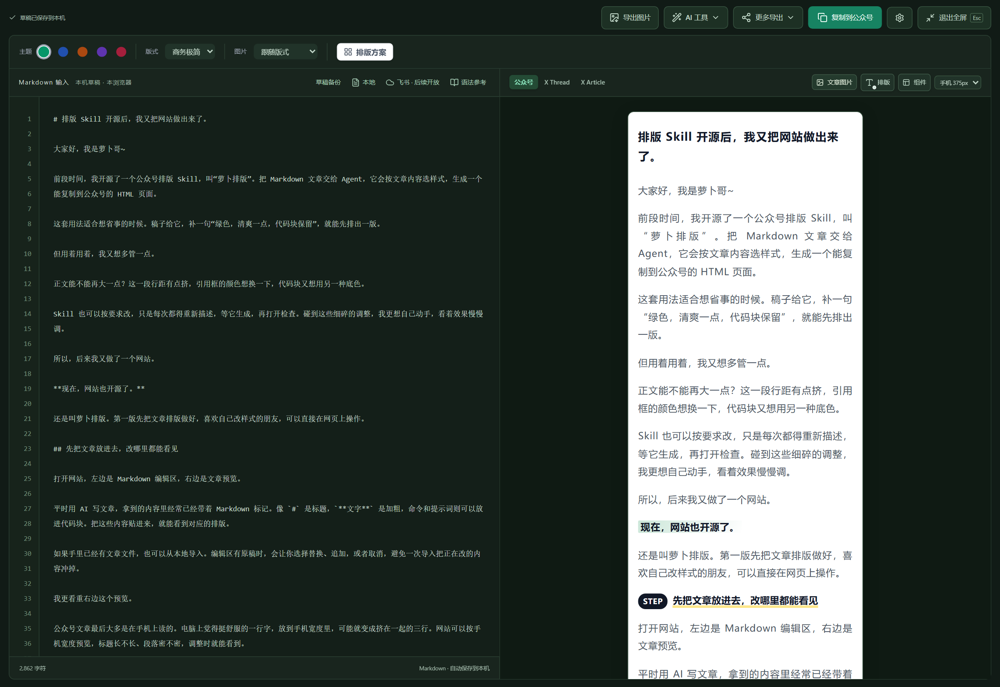
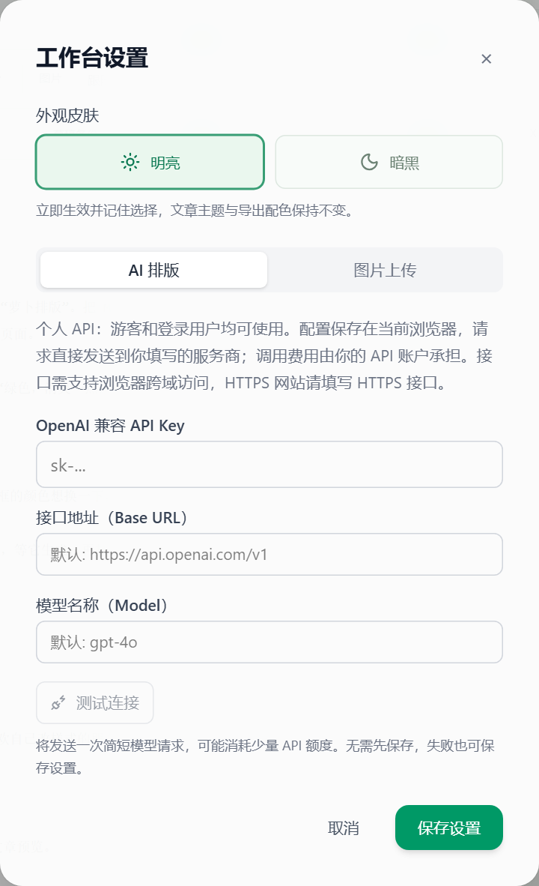
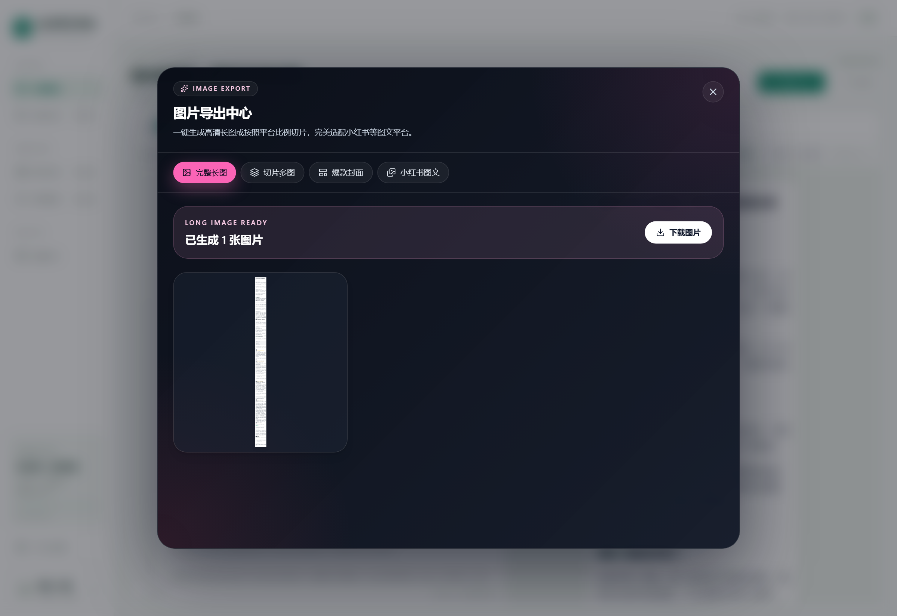
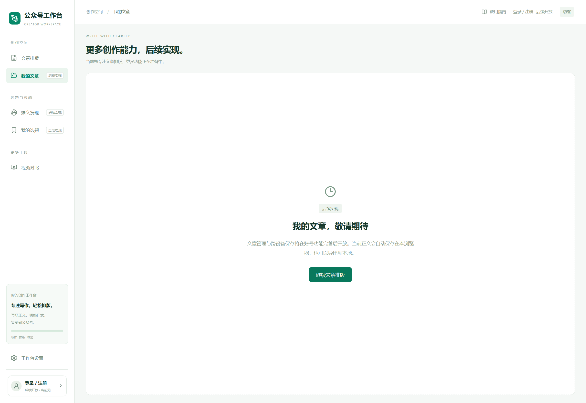

> 历史README，包含早期Cloudflare部署、账号与二期开发记录。当前用户功能及部署方式请以[项目首页](../../README.md)和[发布范围](../RELEASE_SCOPE.md)为准。

# 公众号 Markdown 排版系统

把正文写进 Markdown 编辑器，实时调整文章样式，再复制到公众号或导出图片。

[在线体验](https://gzh.chatgptdaily.com.cn/) · [本地部署](../LOCAL_DEPLOYMENT.md) · [服务器部署](../SELF_HOSTED.md)

## 网站预览

以下为当前生产构建在本地运行的真实界面截图，示例正文仅用于演示排版；公网界面以实际部署版本为准。

### 双栏编辑与实时预览

左侧写正文，右侧查看公众号排版效果，主题、版式和图片样式随时切换。



### 风格方案与排版细节

先选一套完整风格，再按喜好调整字号、行距、段落间距和左右边距。

| 整套风格方案 | 正文排版设置 |
| --- | --- |
|  |  |

### 暗黑皮肤与专注全屏

收起外围界面，给编辑和预览留出更多空间。工作台皮肤与文章导出配色独立设置。



### 个人 API 设置与连接测试

无需登录即可填写 API Key、接口地址与模型，保存前可测试连接。配置保存在当前浏览器，测试会向填写的服务商发起一次短请求，费用由个人 API 账户承担。截图未填写密钥。



### 图片导出

支持文章长图、按平台比例切片，以及封面制作，方便把同一篇内容整理成不同发布形式。



<details>
<summary>后续功能规划</summary>

“我的文章、爆文发现、我的选题”和账号功能目前保留规划入口，后续逐步开放。



</details>

## 当前发布范围

当前生产优先开放排版、个人API及已有导出工具，登录、注册与用户中心暂不开放，入口显示“后续开放”，生产账号接口暂时关闭。“我的文章、爆文发现、我的选题”入口保留并标注“后续实现”，点击展示规划页，实际管理页面与Node接口不开放，详见[发布范围](../RELEASE_SCOPE.md)。后文文章管理和二期能力说明为开发记录，不代表生产已开放。

部署入口：[下载ZIP后本机运行](../LOCAL_DEPLOYMENT.md) · [Linux公网完整部署](../SELF_HOSTED.md)。公网方案使用专用用户gzh、项目目录`/home/gzh/gongzhonghao`、本机端口3100和现有Nginx。每段命令的执行用户见对应指南。

Git安装完成后，日常更新可由root直接执行`bash /home/gzh/gongzhonghao/deploy/update.sh`，自动切换执行身份、拉取、构建、重启及健康检查，见[一键更新脚本](../../deploy/update.sh)。

当前排版工作台在生产环境也支持个人API：游客和登录用户均可在工作台设置填写API Key、Base URL与模型，保存在当前浏览器，用于AI排版、封面和图文生成。请求直接发送到支持浏览器跨域访问的服务商，失败不自动使用平台额度。后续会员平台API见[产品待办](../TODO.md)。下文旧online服务端AI权限说明保留为历史实现参考，当前个人API不要求登录或会员；文章保存、服务器图床、飞书导入、RedFox及选题简报均后续开放。

## 自有 Linux 服务器部署

当前支持 Node.js 22.22.2或24.13+单进程部署，SQLite 和文件目录保存数据，systemd 管理服务，Nginx 提供 HTTPS 反向代理。Node 22.22.2已通过本地兼容性验证，Linux现场仍需启动验收。无需 Cloudflare 账号。完整安装、管理员初始化、备份和验收步骤见 [自有服务器部署指南](../SELF_HOSTED.md)。

```bash
cd app
npm ci
npm run build:server
cd ../server
npm ci
npm run build
test -f .env || cp .env.example .env
# 编辑 .env，设置 PUBLIC_URL 和模型配置
npm start
```

服务器构建使用同域 API，无需在浏览器配置后端地址；服务器上传在生产暂不开放；本地开发上传需要登录，只接受常见位图格式。原内部上传模式名 `r2` 保留用于旧配置兼容，服务器版实际写入本地对象目录。部署模板使用 `127.0.0.1:3100`，持久化数据位于 `server/data/`；代码未设置PORT时的回退值仍为3000，部署时须明确配置PORT。浏览器 MP4 编码保留，WASM 由服务器提供。配图任务使用持久化单路队列，重启后恢复未完成任务，已记录完成的步骤会跳过。仅支持单实例，不要开启多进程集群。

上线前已加入HTML输出过滤、Node账号接口限流、飞书一次性授权state及凭证加密。默认加密密钥位于数据目录的 `.credentials-key`，必须与数据配套持久保管；代理IP信任需显式配置，详见 [安全加固与验证边界](../SECURITY_HARDENING.md)。

当前Linux部署模板使用专用用户 `gzh`，家目录 `/home/gzh`，项目目录 `/home/gzh/gongzhonghao`。旧目录 `/home/ubuntu/gzh` 的停服复制迁移、systemd、管理员初始化与现有Nginx接入步骤见 [完整部署方案](../SELF_HOSTED.md)。

下文 Cloudflare 相关配置作为旧部署路径保留；自有服务器部署不需要执行 Wrangler、D1 或 R2 操作。

面向公众号文章的 Markdown 排版与智能配图系统。

项目维护两套使用方式：

- `OSS / 本地调测版`
  - 适合本地开发、开源分发、UI 调测
  - 前端可用 mock 身份模拟 `guest / free / vip / admin`
  - AI 排版默认由浏览器直连模型
  - 智能配图可本地生成信息图 PNG，用于完整调测交互链路

- `online / 正式上线版`
  - 前端通过 Cloudflare Worker 调用 AI 排版、认证、预设、智能配图
  - AI 排版需要登录
  - 智能配图仅 `vip / admin` 可用
  - 配图任务为异步 Workflow job，完成后由用户确认应用到正文

## 目录结构

- [app](../../app)
  - React + TypeScript + Vite 前端
- [worker](../../worker)
  - Cloudflare Worker + D1 + R2 + Workflows 后端
- [syntax_tutorial.md](../syntax_tutorial.md)
  - Markdown 语法参考素材

## 当前功能

- 顶部“排版方案”统一管理六套精选方案与本机个人方案，无需登录即可保存、改名、编辑、删除及JSON导入导出，见[本机预设](../LOCAL_PRESETS.md)。
- 图片导出、配图面板、语法参考、X预览和视频对比按需加载，首次进入排版页不下载完整工具模块。

- 一期工作台采用侧栏导航、独立外观工具栏和双栏编辑预览；默认手机 375px 预览，可切换至 677px。复制和图片导出使用当前预览宽度。
- 排版页支持“专注全屏”：收起侧栏、工作台标题与底部规划提示，保留编辑预览和常用操作；支持按钮或 Esc 退出。优先使用浏览器原生全屏，不支持时使用页面内专注布局，正文保持不变。
- 在“工作台设置 → 外观皮肤”中选择明亮 / 暗黑皮肤，立即生效并在本机记住选择。全屏内通过设置图标进入同一面板。界面皮肤独立于文章主题，预览纸张、公众号复制和图片导出继续使用文章本身的配色。
- 正文自动保存到本机并显示保存状态；AI 结果须确认采用，覆盖前保留可撤销快照。
- Node 自托管版已接入 RedFox 爆文文章库：管理员手动采集原创榜/十万阅读榜并持久化到 SQLite；浏览、搜索、筛选及分页只查本地库，缺数据时不会自动回源。支持文章详情、个人选题、参考来源、手工/AI原创简报及可撤销带入排版，配置见 [爆文系统说明](../VIRAL_DISCOVERY.md)。真实供应商与模型仍需用部署环境凭证验收；定时采集尚未实现。
- “我的文章”已支持真实账号手动保存标题和Markdown到SQLite、搜索分页、重命名、删除及载入排版。载入前确认并保留撤销快照；并发保存检查版本，不覆盖新版本。图片使用原链接，排版组合使用现有预设；详见 [我的文章](../MY_ARTICLES.md)。
- 编辑器刷新后保留当前文章关联和未保存正文，仍手动保存并检查版本。公众号预览工具栏的“文章图片”支持检测、单处更换链接及登录上传原图替换，可撤销；见 [图片管理](../ARTICLE_IMAGES.md)。

- Markdown 编辑（带行号）+ 实时公众号预览，编辑器滚动时预览按比例跟随
- 标题支持四级层级：`#` 主标题、`##` 章节标题、`###` 小节标题（可选「标签 | 标题」）、`####` 段落小标题，全部随版式切换样式
- 顶栏按“外观设置 / 动作”分组：主题、版式、图片、预设在左侧；右侧为「复制到公众号」主按钮，AI 排版与智能配图收进「AI 工具」菜单，X 复制与导出图片收进「更多导出」菜单
- 右侧预览区按 Tab 切换「公众号 / X Thread / X Article」，X 输出直接在预览栏内查看与逐条复制
- 公众号复制保留链接目标及预格式换行，相对图片地址转为绝对地址；富文本复制失败时明确提示纯文本降级，本机或加载失败的图片会提醒核对。实际公众号后台粘贴与图片转存仍需单独验收，见 [导出检查记录](../WECHAT_EXPORT_QA.md)。
- 单输入、多平台导出
- 图片导出中心：完整长图、按平台比例切片多图、小红书爆款封面（多套模板 + 自定义标题/副标题/主题色 + AI 根据正文生成封面方案）
- 小红书图文生成：AI 把正文拆成封面 + 内容卡的轮播组图（7 种版式），三套视觉系统（杂志风 / 手账风 / 简约风）各 6 套主题包，支持逐张微调文案、溢出提醒与打包下载
- 飞书文档同步（online 模式）：每个用户在侧边栏保存自己创建的飞书自建应用凭证（App ID / Secret，存 D1 按用户隔离），绑定飞书账号后可浏览最近文档或粘贴 docx/wiki 链接，一键导入编辑器；文档图片自动迁移到 R2 图床
- 主题 / 版式 / 图片风格切换
- AI 排版
- 图片上传
- 用户登录
- 云端预设保存
- 智能配图建议
- 智能配图异步生成与手动应用
- X Thread 文案导出与复制
- X Article 文案导出与复制
- X Article 现已支持富文本预览与 `text/html + text/plain` 双格式复制，标题、列表、引用、图片阴影与代码块样式会优先保留
- 对含代码的 X Article，系统会额外拆出可单独复制的代码块，便于粘贴到 X 原生的“插入代码”编辑入口

## 权限规则

`online` 模式下：

- `AI 排版`
  - 必须登录
- `AI 封面方案` / `AI 图文生成`
  - 与 AI 排版共用同一套鉴权（`AI_FORMAT_AUTH_MODE`），online 默认必须登录
- `智能配图建议`
  - 必须 `vip / admin`
- `智能配图生成`
  - 必须 `vip / admin`
- `云端预设`
  - 必须登录
- `飞书文档同步`
  - 必须登录 + 配置自己的飞书应用凭证 + 绑定飞书账号（仅 online 模式）

`oss` 模式下：

- 默认使用 mock 身份
- 可切换 `guest / free / vip / admin`
- 用于调测权限提示、按钮显隐、生成流程
- 不依赖真实用户系统

## 运行模式

前端通过 `.env` 控制双版本。

相关文件：

- [app/.env](../../app/.env)
- [app/.env.oss](../../app/.env.oss)
- [app/.env.online](../../app/.env.online)
- [app/.env.example](../../app/.env.example)

关键前端环境变量：

- `VITE_APP_MODE`
  - `oss` 或 `online`
- `VITE_AUTH_MODE`
  - `mock` / `real` / `off`
- `VITE_ACCESS_MODE`
  - `mock` / `real` / `off`
- `VITE_DEV_USER_ROLE`
  - `guest` / `free` / `vip` / `admin`
- `VITE_WORKER_URL`
  - online 模式下 Worker 地址
- `VITE_WORKER_UPLOAD_SECRET`
  - 可选上传密钥
- `VITE_DEFAULT_UPLOAD_MODE`
  - `base64` / `r2` / `custom`
- `VITE_OSS_AI_LOG_LEVEL`
  - OSS 调测日志级别

## 快速开始

### 1. 安装依赖

```bash
cd app
npm install

cd ../worker
npm install
```

### 2. 本地开发：OSS 模式

```bash
cd app
npm run dev:oss
```

说明：

- 不依赖 Cloudflare Worker 即可调 UI 和大部分前端行为
- 页面调试身份切换器收在设置面板里（仅 mock 模式显示）
- OSS 下 AI 排版需要在前端设置里配置模型 API Key
- OSS 下智能配图可以完整走“建议 -> 确认 -> 生成 -> 应用”流程
- OSS 和 online 现在都支持从同一份 Markdown 直接导出 X Thread / X Article 文案，不会覆盖公众号正文
- X Article 导出会优先写入富文本剪贴板，便于手动粘贴到 X Articles 编辑器；最终保真度仍取决于 X 自身的粘贴处理

### 3. 联调 / 线上前端：online 模式

先配置 [app/.env.online](../../app/.env.online)：

```env
VITE_APP_MODE=online
VITE_AUTH_MODE=real
VITE_ACCESS_MODE=real
VITE_WORKER_URL=https://your-worker.your-subdomain.workers.dev
VITE_WORKER_UPLOAD_SECRET=
VITE_DEFAULT_UPLOAD_MODE=r2
```

然后启动：

```bash
cd app
npm run dev:online
```

## Cloudflare 后端部署

核心配置文件：

- [worker/wrangler.toml](../../worker/wrangler.toml)
- [worker/schema.sql](../../worker/schema.sql)

当前后端绑定：

- `DB`
  - D1 数据库
- `IMAGES_BUCKET`
  - R2 图片与产物存储
- `ILLUSTRATION_WORKFLOW`
  - 智能配图异步任务 Workflow
- `BROWSER`
  - Browser Rendering，用于将 HTML 信息图截图成 PNG

### 1. 准备 D1 / R2 / Workflow / Browser Rendering

你需要在 Cloudflare 侧准备：

- 一个 D1 数据库
- 一个 R2 bucket
- Worker 已启用 Workflows
- 如需 HTML 信息图截图，需启用 Browser Rendering

然后把 `database_id` 填入 [worker/wrangler.toml](../../worker/wrangler.toml)。

### 2. 配置 secrets

必需：

```bash
cd worker
npx wrangler secret put OPENAI_API_KEY
```

可选：

```bash
npx wrangler secret put GEMINI_API_KEY
npx wrangler secret put UPLOAD_SECRET
```

说明：

- `OPENAI_API_KEY`
  - 用于 AI 排版和智能配图建议模型分析
- `GEMINI_API_KEY`
  - 用于 `http_image` 真实生图
- `UPLOAD_SECRET`
  - 兼容旧上传或混合鉴权场景

### 3. 初始化数据库

```bash
cd worker
npx wrangler d1 execute gzh-typesetter-db --file=./schema.sql
```

### 4. 部署 Worker

```bash
cd worker
npm run deploy
```

本地校验：

```bash
cd worker
npm run deploy -- --dry-run
```

## 智能配图说明

### 使用流程

1. 用户点击“智能配图建议”
2. 系统返回建议插图位置、图类型、用途、风格
3. 用户勾选要保留的建议
4. 用户点击生成
5. online 模式下：
   - 创建异步 Workflow job
   - 前端轮询任务状态
   - 完成后在右下角任务面板里手动应用结果
6. oss 模式下：
   - 本地直接生成结果并应用

### 引擎规则

- `http_image`
  - 适合场景图、封面图
  - 需要 `GEMINI_API_KEY`
  - 若未配置或生成失败，会自动回退到 `html_infographic`

- `html_infographic`
  - 适合流程图、对比图、框架图、时间线、信息图
  - 若配置了 `BROWSER`，走 HTML/CSS -> Browser Rendering -> PNG
  - 若未配置 `BROWSER`，回退为结构化 SVG 信息图
  - 当前 `infographic / comparison / flowchart / framework / timeline` 已升级为“结构化内容 -> 模板渲染”，不再直接把原文句子平铺成图
  - online：若 Worker 配置了 `OPENAI_API_KEY`，会先做段落结构化总结，再渲染信息图
  - oss：若本地已配置 `openai_api_key / openai_api_base / openai_model`，也会先做结构化总结；未配置时才退回启发式摘要
  - 结构化总结现在带质量门槛：若结果过于偏“信息图/可视化/扫读/阅读效率”这类元信息，会拒绝并回退到更贴正文的摘要

### 当前行为

- online 模式下，配图任务是异步的，不会在点击后立刻覆盖正文
- 必须等任务完成，再由用户点击“将结果应用到正文”
- 这是有意设计，避免后台任务完成时覆盖用户正在编辑的内容
- 当前 `html_infographic` 的质量优化已覆盖 `infographic / comparison / flowchart / framework / timeline`
  - `infographic` 不再只走“概览卡片”兜底，会先判断更适合 `bridge / linear-progression / overview` 哪种布局
  - online：优先使用模型生成结构化信息与布局，再渲染为 HTML 信息图
  - oss：优先使用本地模型生成结构化信息与布局；未配置模型时才退回启发式结构化摘要

## 认证与角色维护

网站右上角“登录 / 注册”进入账号页面，支持邮箱注册、密码登录、退出和登录后返回原页面。注册密码至少8位且同时包含字母和数字，新账号为 `free`，服务端会话有效期7天；密码使用现有PBKDF2哈希保存。登录页支持明暗皮肤和手机布局。

左下角账号区域未登录时显示明显的“登录 / 注册”按钮；登录后点击“用户中心”进入 `/account`，可查看邮箱、账号类型、注册时间，修改密码或退出。手机端可通过导航菜单进入用户中心。用户中心要求真实账号，调试身份不能代替登录。用户及会话默认保存在 `server/data/gzh.sqlite`，修改密码后其他设备的会话失效，当前会话保留。

本地 `app/npm run dev` 也能真实注册与登录，账号和会话保存在 `server/data/gzh.sqlite`，无需另起后端。未登录时仍可在设置中使用调试身份；真实账号优先于调试身份，退出后回到游客。生产环境角色以服务端会话为准。文章草稿继续保存在浏览器，登录不会迁移或覆盖原稿。

正文草稿、撤销快照和选题导入记录现按真实账号隔离，访客与旧版草稿独立保留，登录后可手动恢复，见 [本机草稿与恢复](../LOCAL_DRAFTS.md)。账号过期或切换时会保存原账号正文；草稿暂不跨设备同步。

当前没有邮件验证和自助邮件找回密码；忘记密码沿用管理员重置接口。账号基础能力与未来高级功能收费规划分开，未新增支付或付费限制。

数据库用户表定义见 [worker/schema.sql](../../worker/schema.sql)。

角色：

- `free`
- `vip`
- `admin`

角色变更优先使用 admin API（用 admin 账号的 Bearer token 调用）：

```bash
curl -X POST "https://your-worker.workers.dev/api/admin/users/role" \
  -H "Authorization: Bearer <admin-token>" \
  -H "Content-Type: application/json" \
  -d '{"email": "your-test-account@example.com", "role": "vip"}'
```

忘记密码时可由 admin 重置（重置后该用户所有会话失效，需重新登录）：

```bash
curl -X POST "https://your-worker.workers.dev/api/admin/users/reset-password" \
  -H "Authorization: Bearer <admin-token>" \
  -H "Content-Type: application/json" \
  -d '{"email": "your-test-account@example.com", "newPassword": "newpass123"}'
```

联调阶段也可以直接在 D1 中手工升级测试账号为 VIP（备选方式）：

```sql
UPDATE users
SET role = 'vip'
WHERE email = 'your-test-account@example.com';
```

说明：

- 目前还没有独立的 VIP 运营后台
- 线上 VIP 管理优先走 admin API，数据库直改为备选
- 登出：`POST /api/auth/logout` 会在服务端删除当前会话
- 改密：`POST /api/auth/change-password`（需登录），修改后其他设备强制下线
- 登录限流：同一邮箱 10 分钟内失败 5 次后返回 429，登录成功自动清零
- 密码使用 PBKDF2 存储，旧 SHA-256 账号在下次登录时自动迁移

## 日志与排障

### Worker 日志

```bash
cd worker
npx wrangler tail
```

适用：

- online 模式 AI 排版
- online 模式智能配图建议
- online 模式智能配图任务
- online 模式智能配图的结构化总结、引擎回退、任务编排

### OSS 模式日志

```bash
cd app
npm run dev:oss
```

然后看前端 dev server 终端输出。

说明：

- OSS 模式不会经过 Worker，所以 `wrangler tail` 看不到前端直连模型的日志
- 可通过 `VITE_OSS_AI_LOG_LEVEL` 控制本地日志详细程度
- OSS 模式下，智能配图也会输出本地日志，前缀为 `[oss-illustration]`
- 控制台页面现在自带“本地环境诊断”面板；online 模式下管理员还可以在同一页面查看 Worker 诊断结果

### 常见问题

1. `wrangler tail` 没日志
- 很可能当前跑的是 `oss` 模式
- 或 `online` 模式下 `VITE_WORKER_URL` 没配对

2. 图片上传成功但打不开
- 检查 Worker `/file/*` 路由是否部署成功
- 检查 `VITE_WORKER_URL` 是否指向当前 Worker

3. online 智能配图一直不完成
- 先看 `wrangler tail`
- 再看 D1 是否已应用最新 schema
- 再检查 `BROWSER` / `GEMINI_API_KEY` 是否已配置

4. 配图创建后正文没有立刻变化
- 这是当前设计
- online 模式下需要等待异步任务完成后手动应用结果

5. online 配置看起来没问题，但还是不确定 Worker 是否真的配全
- 先用管理员账号打开控制台页面
- 查看“线上 Worker 诊断”里的 bindings、secrets、schema 和最近任务

## 日常维护清单

每次上线前至少检查：

- 前端环境变量是否对应当前模式
- `VITE_WORKER_URL` 是否正确
- D1 是否已执行最新 [schema.sql](../../worker/schema.sql)
- Worker secrets 是否齐全
- `wrangler.toml` 绑定是否与 Cloudflare 控制台一致
- `npm run build:oss`
- `npm run build:online`
- `cd worker && npm run deploy -- --dry-run`

## 文档维护约定

这份 [README.md](../../README.md) 作为项目整体的主说明文档。

后续凡是出现以下行为变动，都必须同步更新本文件：

- 权限规则变化
- AI 排版调用方式变化
- 智能配图流程变化
- Cloudflare 绑定变化
- 环境变量变化
- 部署步骤变化
- 线上运维方式变化
- 用户可见交互变化

建议把这条作为提交前检查项：

- “如果这次改动改变了系统行为，README 是否已同步更新？”

## 子文档

- 后续高级付费功能见 [产品待办](../TODO.md)。

日常本地开发可直接在 `app` 目录执行 `npm run dev`，OSS模式的Vite服务已内置本地文章库接口，使用 `server/data/gzh.sqlite`。打开页面后用工作台设置的“调试身份”控制访问，默认VIP；无需另外启动Node后端，也不会调用付费采集或AI服务。此开发接口仅接受本机请求，不包含在生产构建中。

本地调测爆文发现：先在 `app` 目录执行 `npm run build:server`，再在 `server` 目录执行 `npm run dev:local`，打开 `http://127.0.0.1:3000/discovery`，在工作台设置的“调试身份”中选择免费用户、VIP用户或管理员即可免登录浏览文章及编辑选题；选择未登录则显示登录提示。排版页与爆文页共用这一选择。该命令仅绑定本机，调测选题按身份分别保存在当前 SQLite 数据库。采集和 AI 生成仍需真实登录。正常 `npm start` 和生产环境不启用免登录。

- 部署上线见 [DEPLOYMENT.md](../DEPLOYMENT.md)
- 前端说明见 [app/README.md](../../app/README.md)
- Worker 说明见 [worker/README.md](../../worker/README.md)
